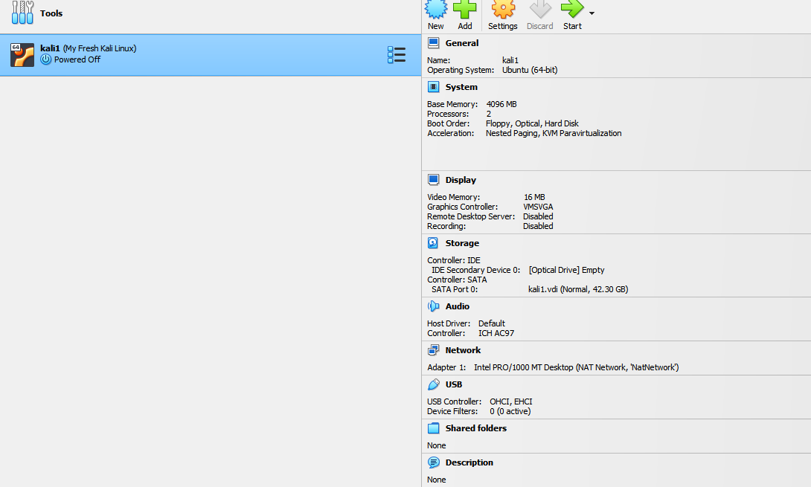
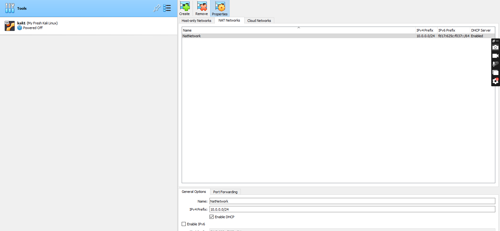
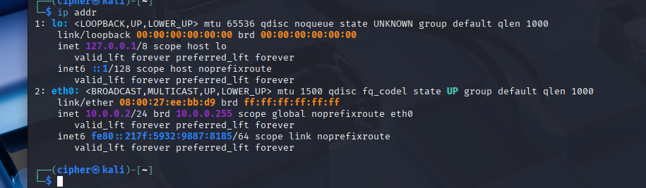
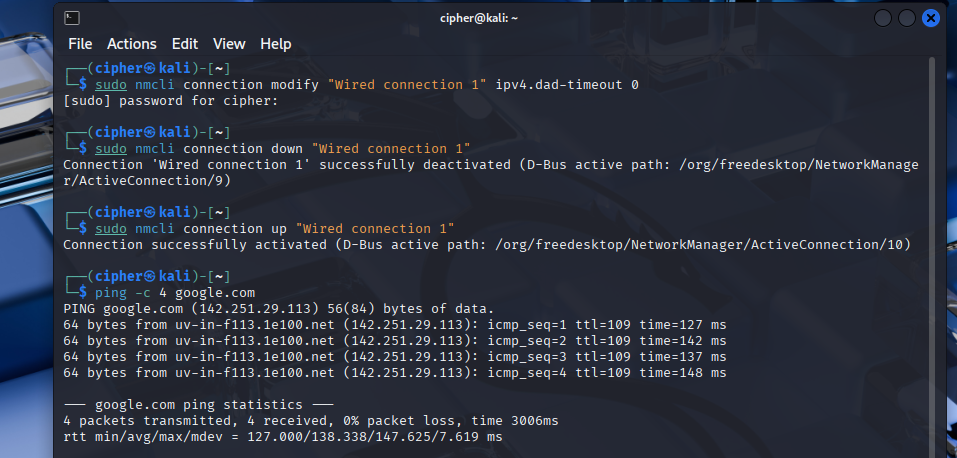
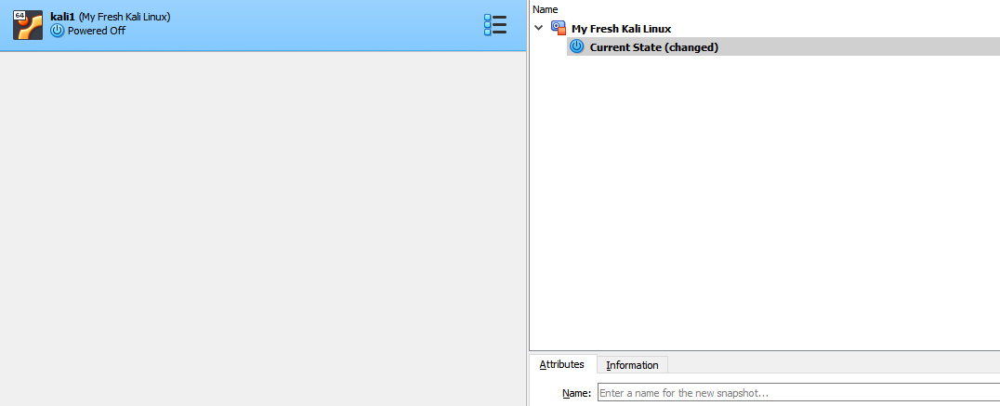
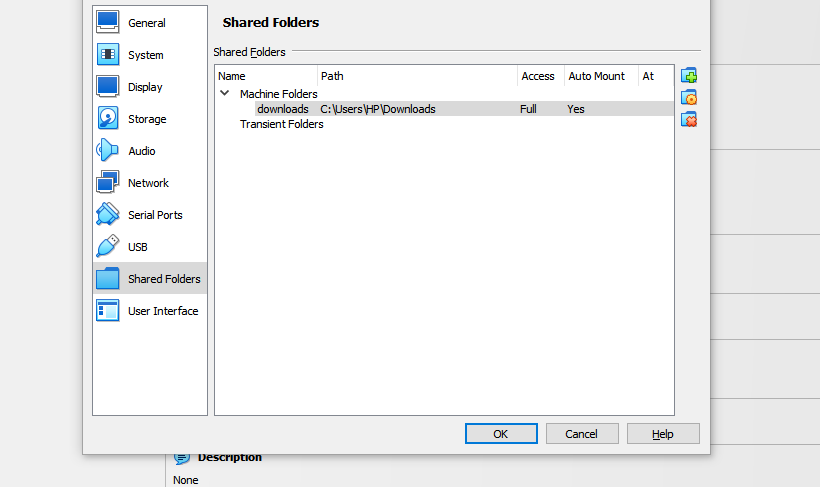
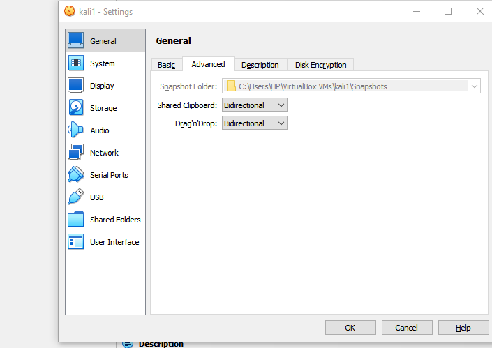

# 🔐 Cybersecurity Lab Environment Setup

**Networkwalks Cybersecurity Internship – Batch B084**

---

## 📌 Project Overview

This project involves setting up a cybersecurity lab environment using Oracle VirtualBox and Kali Linux. The lab provides a virtual environment for learning and practising cybersecurity activities.

## 🎯 Objectives

- Install and configure VirtualBox.
- Set up a NAT Network using the `10.0.0.0/24` subnet.
- Import Kali Linux into VirtualBox.
- Configure the Kali Linux network.
- Enable clipboard and drag-and-drop functionality.
- Configure a shared folder.
- Take a snapshot of the Kali Linux virtual machine.

## 🛡️ Purpose of the Lab

The purpose of this project is to create a virtual cybersecurity laboratory where practical cybersecurity exercises can be performed in an isolated virtual environment.

## 🏗️ Lab Architecture

The lab uses Oracle VirtualBox as the virtualization platform and Kali Linux as the attacking machine.

**Network Configuration:**

- Network Type: NAT Network
- Network Subnet: `10.0.0.0/24`
- Kali Linux IP Address: `10.0.0.2/24`
- Internet Access: Required

 
## ⚙️ Lab Configuration

The following configurations are required according to the project material:

- VirtualBox installed as the virtualization platform.
- Kali Linux configured as the attacking machine.
- NAT Network configured with the `10.0.0.0/24` subnet.
- Clipboard and drag-and-drop enabled.
- Shared folder enabled using the host machine's `/downloads` folder.
- Kali Linux assigned the IP address `10.0.0.2/24`.
- Full internet access configured for Kali Linux.

---

# 🪜 Lab Setup Procedure

## Step 1: Download and Install 7-Zip

7-Zip was used as the archive utility for the lab setup.

Download: [7-Zip](https://7-zip.org/download.html)

## Step 2: Download and Install VirtualBox

Oracle VirtualBox was downloaded and installed as the virtualization platform.

Download: [Oracle VirtualBox](https://virtualbox.org/wiki/Downloads)

## Step 3: Configure VirtualBox Network Settings

A NAT Network was created in VirtualBox using the required subnet:

`10.0.0.0/24`

## Step 4: Download and Import Kali Linux

Kali Linux was downloaded and imported into VirtualBox to serve as the attacking machine.

Download: [Kali Linux](https://www.kali.org/get-kali/)

## Step 5: Configure Kali Linux IP Address

The Kali Linux network configuration was set up according to the project requirements.

Required IP address:

`10.0.0.2/24`

## Step 6: Take a Snapshot of the Virtual Machine

A snapshot of the configured virtual machine was created to preserve its current state.

---
## Step 7: Shared Folder Configuration

A shared folder was configured in VirtualBox to allow file sharing between the host machine and the Kali Linux virtual machine. The folder was named `downloads`, with Auto-mount and Make Permanent enabled.

## Step 8: Shared Clipboard and Drag-and-Drop

Shared Clipboard and Drag-and-Drop were enabled in VirtualBox using the Bidirectional option to allow data transfer between the host machine and Kali Linux.

# 🔎 Lab Verification

The following requirements were checked:

- Kali Linux has the required IP address.
- Kali Linux has internet access.
- VirtualBox NAT Network is configured correctly.
- Clipboard and drag-and-drop are enabled.
- Shared folder is configured.
- Virtual machine snapshot is created.

---

# 🐞 Problems Encountered & Solutions

I experienced an internet connectivity problem and resolved it using the troubleshooting commands in the lab setup material

---

# 💡 What I Learned

This section highlights the knowledge and practical skills gained while completing the cybersecurity lab setup.

---

# 🔐 Security & Ethical Use

This virtual lab is intended for cybersecurity education, practical learning and authorized testing.

---

# 🔗 Tools & Resources

1. 7-Zip: https://7-zip.org/download.html
2. Oracle VirtualBox: https://virtualbox.org/wiki/Downloads
3. Kali Linux: https://www.kali.org/get-kali/

---

# 👤 Author

**Name:** Melchizedek  
**Batch:** B084  
**Program:** Networkwalks Cybersecurity Internship

---

## 📌 Project Information

**Project:** Cybersecurity Lab Setup  
**Week:** Week 1  
**Module:** Project Module 1  
**Platform:** GitHub
